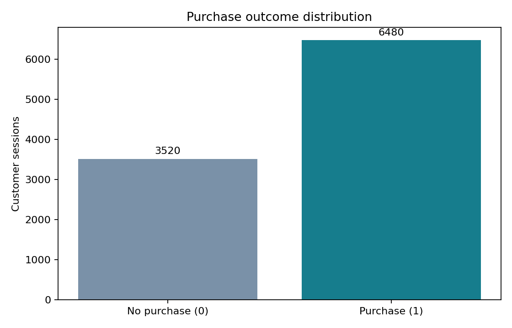
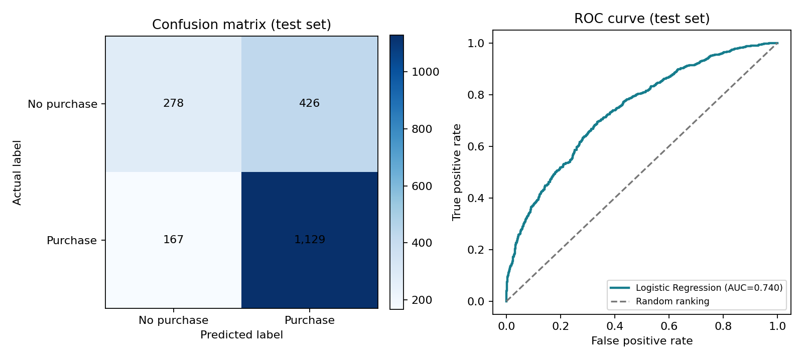

# E-Commerce Customer Purchase Prediction

**ShopSmart | Supervised binary classification | Logistic Regression**

This project follows the supplied Sapphire IQ brief. It explores customer/session data, prepares missing and extreme values, encodes categories, scales numeric features, trains a Logistic Regression model, evaluates it on a holdout set, and produces example predictions for new customers.

## Target and data

- `Purchase = 0`: no purchase during the session
- `Purchase = 1`: purchase during the session
- Dataset: 10,000 rows and 19 columns, including the target and a customer identifier
- `Customer_ID` is excluded from model inputs because it is an identifier rather than a behavioral predictor.
- The supplied data has 2,514 missing cells and no fully duplicated rows. The pipeline imputes missing values rather than dropping customer records.

## Holdout results

The model was evaluated on a stratified 20% test split (2,000 rows, random seed 42). The classification threshold is 0.50.

| Measure | Test result |
|---|---:|
| Accuracy | 70.35% |
| Precision | 72.60% |
| Recall | 87.11% |
| F1-score | 79.20% |
| ROC-AUC | 0.740 |
| Majority-class accuracy baseline | 64.80% |

The confusion matrix, with actual classes as rows and predicted classes as columns in the order `0, 1`, is `[[278, 426], [167, 1129]]`. The selected threshold favors finding likely purchasers, which also creates false positives. Use predictions to prioritize a campaign for human review; this model does not establish that an offer will cause a purchase.

## Method

1. Split the records into training and test sets with `stratify=Purchase` and a fixed seed.
2. For numeric fields, impute the median, cap values at training-set IQR fences, and standardize.
3. For categorical fields, impute the most frequent category and one-hot encode.
4. Fit Logistic Regression and report accuracy, precision, recall, F1-score, confusion matrix, and ROC-AUC on the untouched test split.
5. Save the fitted preprocessing/model pipeline and sample predictions.

All preprocessing is inside the model pipeline so imputation, outlier caps, scaling, and category encoding are learned from the training data only. The results are a single holdout evaluation; they are not a guarantee of performance on future traffic.

## Run the project

Use Python 3.10 or newer. `requirements.txt` pins the tested library versions so the saved model and regenerated results stay consistent. From this project folder:

```bash
python -m pip install -r requirements.txt
python -m src.modeling
```

To open and run the explanatory notebook:

```bash
python -m pip install jupyter
jupyter notebook notebooks/Ecommerce_Purchase_Prediction.ipynb
```

To score a CSV of new customers, include the same predictor columns as the supplied dataset (the `Customer_ID` and `Purchase` columns are optional and ignored). Then run:

```bash
python -m src.predict path/to/new_customers.csv --output results/predictions.csv
```

The notebook expects the project folder as its working directory. `python -m src.modeling` recreates the model, evaluation figures, metrics, and prediction CSV files.

## Repository contents

```text
data/       Supplied CSV dataset
models/     Fitted scikit-learn pipeline
notebooks/  Exploratory and modeling walkthrough
reports/    Submission report and generated figures
results/    Metrics, holdout predictions, and new-customer examples
src/        Reusable modeling and report-generation code
```

Main deliverables:

- `notebooks/Ecommerce_Purchase_Prediction.ipynb` — project walkthrough
- `reports/Ecommerce_Customer_Purchase_Prediction_Report.pdf` — formatted project report
- `models/logistic_regression_pipeline.joblib` — fitted inference pipeline
- `results/metrics.json` — machine-readable evaluation results
- `results/sample_new_customers.csv` — three example input profiles
- `results/sample_new_customer_predictions.csv` — their predicted classes and purchase probabilities





## Interpretation and limitations

In this dataset, observed purchase rate varies across membership categories (about 72.1% for Premium, 66.1% for Regular, and 61.0% for New). These are descriptive associations, not causal effects. Logistic regression coefficients are also associations conditional on the included predictors. The dataset documentation does not state how the records were sampled or generated, so external validity cannot be established from this project alone. Before operational use, validate on later time periods, agree on the cost of false positives versus missed purchasers, and monitor performance and data quality.

The report and notebook describe the model as a decision-support prototype. They do not claim a production deployment or a measured increase in sales.
